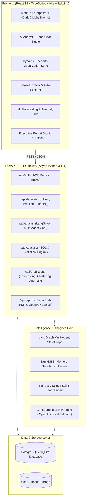
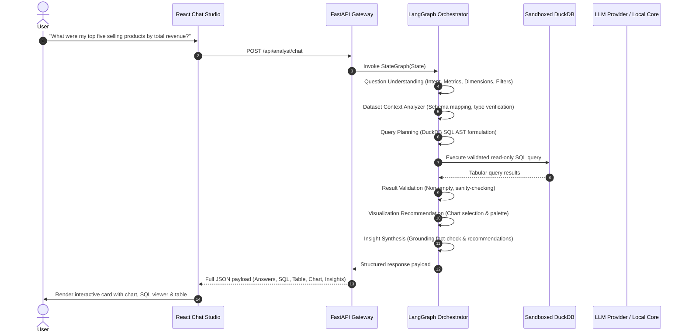

# InsightIQ – Autonomous AI-Powered Data Analyst Agent

[](https://python.org)
[](https://fastapi.tiangolo.com)
[](https://github.com/langchain-ai/langgraph)
[](https://duckdb.org)
[](https://react.dev)
[](https://typescriptlang.org)
[](https://tailwindcss.com)
[](LICENSE)

> **InsightIQ** is an industry-grade autonomous AI data analytics platform that empowers users to upload complex structured datasets (CSV, XLSX, XLS) and converse with their data in plain English. The platform autonomously understands user queries, plans and validates sandboxed DuckDB SQL and Python routines, generates dynamic visualizations, runs predictive machine learning models, and compiles executive PDF and Excel reports.

---

## 🌟 Key Features

- 🤖 **Autonomous Multi-Agent Orchestration (LangGraph)**:
  - 7-node pipeline: Question Understanding ➔ Schema Context ➔ Query Planning ➔ Safe DuckDB Execution ➔ Result Validation ➔ Dynamic Visualization ➔ Grounded Insight Synthesis.
- 🛡️ **Zero-Trust SQL Sandboxing**:
  - Sandboxed in-memory DuckDB engine with strict AST token parsing (`sqlparse`), read-only `SELECT` allowlist enforcement, timeout guards, and user tenant isolation.
- 📊 **Dynamic Interactive Visualization Engine**:
  - Automatic chart recommendation (Bar, Line, Area, Pie, Scatter, Histogram) powered by Recharts with CSV data and SVG/PNG export.
- 📈 **Predictive Analytics & Forecasting**:
  - Time-series linear & random forest forecasting with model evaluation metrics ($R^2$, RMSE, MAE).
  - Multivariate anomaly detection using Scikit-Learn **Isolation Forests**.
  - Unsupervised customer/item segmentation using **K-Means Clustering** with Silhouette quality scoring.
- 📑 **Publication-Ready Executive Reports**:
  - Beautiful, styled executive **PDF reports** generated via **ReportLab**.
  - Multi-tab **Excel workbooks** with formatted KPI summaries, schema profiles, and raw data samples via **OpenPyXL**.
- 🗄️ **Comprehensive Dataset Management & Profiling**:
  - Drag-and-drop file ingestion supporting CSV, XLSX, and XLS.
  - Automatic profiling: data type detection, null percentages, duplicate row identification, parametric statistics, and assisted data cleaning.
- 🔐 **Enterprise Security & Authentication**:
  - Bcrypt-hashed credentials, JWT access & refresh token rotation, CORS controls, and role-based tenant separation.

---

## 🏗️ System Architecture



---

## 🔄 Multi-Agent Pipeline Topology



---

## 💻 Tech Stack

| Domain | Technology | Purpose |
| :--- | :--- | :--- |
| **Frontend** | React 18, TypeScript, Vite | Modern, high-performance user interface |
| **Styling** | Tailwind CSS, Lucide Icons | Responsive enterprise dark/light SaaS design |
| **Charts** | Recharts, SVG | Interactive, responsive data visualizations |
| **State & API** | Axios, TanStack Query | JWT management, query caching, token rotation |
| **Backend** | Python 3.11+, FastAPI, Pydantic v2 | High-throughput async REST API |
| **AI Orchestration**| LangGraph, LangChain Core | Autonomous multi-agent cyclical workflows |
| **LLM Provider** | Google Gemini (`google-genai`), OpenAI | Configurable LLM abstraction with local fallback |
| **SQL Engine** | DuckDB 2.0, SQLParse | Sandboxed columnar query execution |
| **Data Science** | Pandas, NumPy, Scikit-learn, SciPy | Profiling, regression forecasting, clustering |
| **Reports** | ReportLab, OpenPyXL | Publication PDF & multi-sheet Excel generation |
| **Database** | PostgreSQL (Supabase ready), SQLite | Metadata, sessions, and audit logging |
| **Container** | Docker, Docker Compose | Multi-stage production containerization |

---

## 🚀 Quickstart Guide

### 1. Prerequisites
- **Python 3.11+** installed
- **Node.js v18+** and **npm** installed
- **Git**

### 2. Clone Repository
```bash
git clone https://github.com/Vaibhav-dev74/AI-Data-Analyst-Agent.git
cd AI-Data-Analyst-Agent
```

### 3. Backend Setup
```bash
# Navigate to backend
cd backend

# Create & activate virtual environment (optional)
python -m venv venv
# Windows:
.\venv\Scripts\activate
# Linux/macOS:
source venv/bin/activate

# Install dependencies
pip install -r requirements.txt

# Start FastAPI backend server
python -m uvicorn app.main:app --host 0.0.0.0 --port 8000 --reload
```
The backend API is now running at `http://localhost:8000`.
- API Docs: `http://localhost:8000/api/docs`
- Health check: `http://localhost:8000/api/health`

### 4. Frontend Setup
In a new terminal window:
```bash
# Navigate to frontend
cd frontend

# Install packages
npm install

# Start Vite development server
npm run dev
```
The frontend is now running at `http://localhost:5173`.

---

## 🧪 Running Automated Tests

Run the full automated test suite covering authentication, dataset profiling, SQL sandboxing, machine learning predictions, and report generation:

```bash
python -m pytest backend/tests -v
```

Output:
```
============================= test session starts =============================
backend/tests/test_agent.py::test_analyst_agent_chat_workflow PASSED     [ 10%]
backend/tests/test_auth.py::test_user_registration_and_login PASSED      [ 20%]
backend/tests/test_auth.py::test_invalid_login PASSED                    [ 30%]
backend/tests/test_datasets.py::test_dataset_upload_and_preview PASSED   [ 40%]
backend/tests/test_datasets.py::test_invalid_file_extension PASSED       [ 50%]
backend/tests/test_predictions.py::test_ml_prediction_workflows PASSED   [ 60%]
backend/tests/test_reports.py::test_pdf_and_excel_report_generation PASSED [ 70%]
backend/tests/test_sql_sandboxing.py::test_sql_validation_allowlist PASSED [ 80%]
backend/tests/test_sql_sandboxing.py::test_sql_validation_blocks_destructive_keywords PASSED [ 90%]
backend/tests/test_sql_sandboxing.py::test_duckdb_execution_on_csv PASSED [100%]
============================= 10 passed in 6.37s ==============================
```

---

## 📁 Included Sample Datasets

Located in `sample_datasets/` for instant evaluation:
1. `sales_data.csv`: 500 e-commerce transactions across Regions, Categories, Products, Units Sold, Discounts, Revenues, and Profits.
2. `customer_churn.csv`: 300 customer profiles with tenure, monthly charges, contract types, support tickets, satisfaction scores, and churn indicators.
3. `financial_quarterly.xlsx`: 16 quarters of corporate revenue, opex, net income, profit margins, active customers, and ARPU.

---

## 🐳 Docker Deployment

To launch the full stack with PostgreSQL, FastAPI, and React in Docker:

```bash
docker compose up -d --build
```

---

## 📖 Available Documentation

- [System Architecture Specification](docs/architecture.md)
- [REST API Reference](docs/api_documentation.md)
- [Production Deployment Guide](docs/deployment_guide.md)

---

## 📄 License

This project is licensed under the MIT License.
