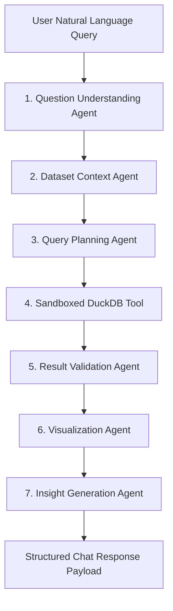

# InsightIQ System Architecture

## 1. System Philosophy

InsightIQ is architected around **strict analytical grounding and sandbox safety**:
- **No Hallucinated Statistics**: The system never generates factual numbers without executing verified code on underlying datasets.
- **Sandboxed Execution**: DuckDB operates strictly in memory with parsed SQL allowlists, preventing any file modifications, shell escapes, or data tampering.
- **Provider-Agnostic LLM Routing**: Seamless abstraction supporting Google Gemini API, OpenAI-compatible APIs, and local deterministic analytical fallback engines.

---

## 2. Multi-Agent Pipeline Topology (LangGraph)

### Agent Responsibilities

| Agent Node | Role | Safety Controls |
| :--- | :--- | :--- |
| **Question Understanding** | Extracts metric targets, categorical dimensions, filters, and limit intents. | Structured JSON schema enforcement. |
| **Context Analyzer** | Maps extracted targets to verified schema column names and semantic types. | Rejects references to non-existent columns. |
| **Query Planner** | Formulates optimal DuckDB SQL expressions or statistical aggregations. | Enforces strict SELECT only statements, avoids wildcard full table memory dumps. |
| **Executor Tool** | Connects to isolated in-memory DuckDB instance with dataset view registered. | Blocks keywords: DROP, ALTER, TRUNCATE, DELETE, INSERT, UPDATE, PRAGMA, ATTACH. |
| **Result Validator** | Confirms row counts, non-empty results, and absence of all-null columns. | Flags empty sets and halts hallucinated inferences. |
| **Visualization Agent** | Evaluates column cardinalities, dates, and numbers to configure Recharts specs. | Selects optimal chart: Line, Bar, Area, Pie, Scatter, Histogram. |
| **Insight Synthesizer** | Produces natural narrative and strategic recommendations grounded in numbers. | Numerical statements cross-checked against computed results. |

---

## 3. Database & Storage Architecture

InsightIQ uses a dual storage paradigm:
1. **Metadata & Relational Storage**:
   - Manages Users, Datasets, Columns, Chat Sessions, Messages, Analysis Results, Reports, and Predictions.
   - Built on SQLAlchemy 2.0 with cross-dialect support for PostgreSQL (Production) and SQLite (Local).
2. **Tabular Data Processing Storage**:
   - Datasets are stored as raw immutable files (CSV, XLSX, XLS) in user-isolated storage.
   - DuckDB queries data directly using zero-copy / memory-mapped vectorized scanning.
